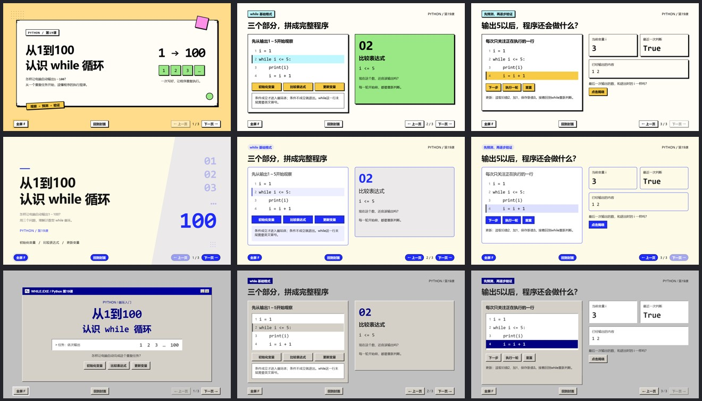

# Teaching Courseware Workflow

[简体中文](README.md) · English

A Codex lesson-preparation workflow for **programming and mathematics teachers**. Turn an outline, an existing slide deck, or teaching material into **interactive HTML slides that work offline**. Try three designs before choosing a style for the full lesson. Add an **editable Word worksheet with a separate answer page** when you need one.

## Built on two projects by Zara Zhang

| Upstream project | What the original does | How this workflow uses it |
| --- | --- | --- |
| **Frontend Slides** | Helps a coding agent build web presentations from scratch or convert PowerPoint files to HTML. It provides a fixed 16:9 stage, single-file HTML, and visual previews to help users choose a style. [Original project](https://github.com/zarazhangrui/frontend-slides) | `$frontend-slides` is the main lesson-preparation entry point. It handles the outline, coordinates style selection, and builds and checks the final deck. |
| **Beautiful HTML Templates** | Provides reusable HTML slide designs for coding agents. An agent matches a brief against the catalog, chooses a template, and adapts its layouts to the user's content. Template folders provide HTML, metadata, and design notes. [Original project and gallery](https://github.com/zarazhangrui/beautiful-html-templates#gallery) | `$beautiful-html-templates` provides 34 visual templates. Use it on its own or let the main workflow call it for style selection. |

## Classroom changes by lianshu-codex

1. **Confirm the lesson structure before designing slides.** Programming lessons begin with an outline for the teacher to review. A slide usually covers one or two learning objectives. Students see a concrete example before the teacher explains the concept, code, and execution. Use 20-point body text, code sized for projection, and slide backgrounds without images. The teaching rules are in [AGENTS.md](AGENTS.md).
2. **Compare three working previews of exactly three slides each.** Options A, B, and C each come as a navigable HTML file. Slide 1 is the cover. Slides 2 and 3 show the same two key teaching pages in all three styles, using real lesson content. Teachers can try the controls and compare code legibility, layout, and interactions before choosing.
3. **Clean up the current preview round after selection.** Remove the unselected HTML previews and assets exclusive to them. Keep the selected previews. Both HTML skills share one preview and cleanup cycle when used together. A specified style or a targeted edit can use the existing design directly.
4. **Support classroom projection and interaction.** Previews and decks work offline and offer a fullscreen button and the `F` shortcut. Students can predict an outcome, then step through variable changes, loops, or function execution. Teachers reveal answers on demand. Programming decks use 1.2-second slide transitions. In debugging exercises, students identify the line first and then the specific error, followed by independent coding tasks at three difficulty levels.
5. **Offer a worksheet during lesson preparation.** When the teacher has not specified whether they want a worksheet, either HTML entry point asks once. Once requested, the worksheet uses the lesson objectives and checks for duplicate questions against the slides and in-class practice. The standalone Word skill also supports multiple-choice, fill-in-the-blank, true-or-false, and open-response questions in an editable two-column layout with a separate answer page.

## Try the three previews

All three versions of the same Python `while` lesson use the same cover content, explanation of loop structure, and step-by-step execution demo.

Download an HTML file and open it in your browser. [A Color Blocks](examples/while-preview-a.html) · [B Blue Handout](examples/while-preview-b.html) · [C Retro Window](examples/while-preview-c.html) · [Word worksheet sample](examples/worksheet-sample.docx)

## Use with Codex

Download or clone the repository and open its root folder in Codex. Include the topic, student level, learning objectives, and any source material in your request.

| Entry point | Use it for |
| --- | --- |
| `$frontend-slides` | Prepare and build a complete interactive lesson. Uses the template library when available. |
| `$beautiful-html-templates` | Browse, compare, or apply HTML templates directly. |
| `$artifact-template-maths-worksheet-2` | Create an editable Word worksheet and answers on their own. |

> Use $frontend-slides to prepare a lesson on while loops for Python beginners. Let students predict the output, then step through variable changes. Show me the lesson outline first. After I confirm it, show three style previews.

PowerPoint conversion requires Python and `python-pptx`. Microsoft Word is recommended for checking worksheet layout. To add a decorative sticker, put transparent PNG files you have permission to use in `assets/stickers/`. The worksheet skill can place one at the bottom left of a student page.

## Credits and license

[lianshu-codex](https://github.com/lianshu-codex) adapted the lesson workflow and assembled the Word worksheet templates. Thanks to Zara Zhang for the two upstream projects. Both retain their original MIT licenses: [Frontend Slides](.agents/skills/frontend-slides/LICENSE) · [Beautiful HTML Templates](.agents/skills/beautiful-html-templates/LICENSE). Additions in this repository are released under the [MIT license](LICENSE).
