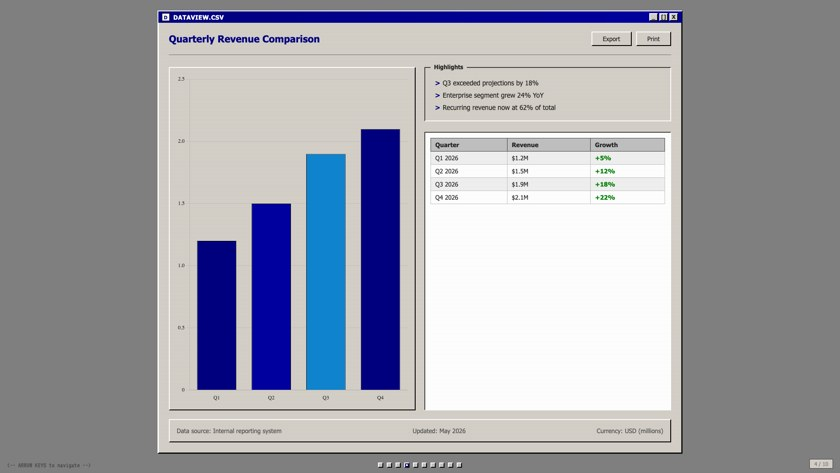
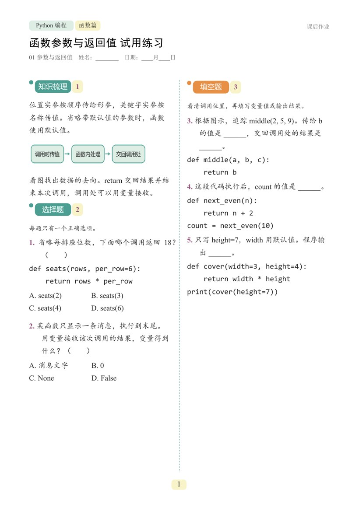
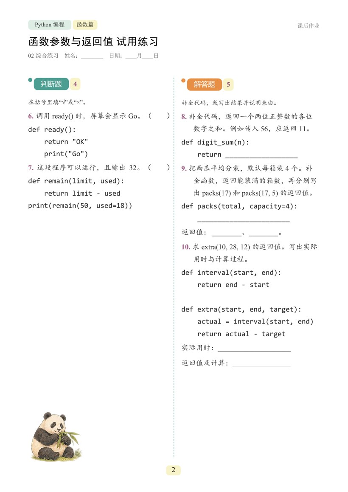

# Teaching Courseware Workflow

[简体中文](README.md) · English

A Codex lesson-preparation workflow for **programming and mathematics teachers**. Turn an outline, an existing slide deck, or teaching material into **interactive HTML slides that work offline**. Both previews and finished decks include fullscreen and a classroom pen. Try three designs before choosing a style for the full lesson. Add an **editable Word worksheet with a separate answer page** when you need one.

## Built on two projects by Zara Zhang

| Upstream project | What the original does | How this workflow uses it |
| --- | --- | --- |
| **Frontend Slides** | Helps a coding agent build web presentations from scratch or convert PowerPoint files to HTML. It provides a fixed 16:9 stage, single-file HTML, and visual previews to help users choose a style. [Original project](https://github.com/zarazhangrui/frontend-slides) | `$frontend-slides` is the main lesson-preparation entry point. It handles the outline, coordinates style selection, and builds and checks the final deck. |
| **Beautiful HTML Templates** | Provides reusable HTML slide designs for coding agents. An agent matches a brief against the catalog, chooses a template, and adapts its layouts to the user's content. Template folders provide HTML, metadata, and design notes. [Original project and gallery](https://github.com/zarazhangrui/beautiful-html-templates#gallery) | `$beautiful-html-templates` provides 34 visual templates. Use it on its own or let the main workflow call it for style selection. |

## Classroom changes by lianshu-codex

1. **Confirm the lesson structure before designing slides.** Programming lessons begin with an outline for the teacher to review. A slide usually covers one or two learning objectives. Students see a concrete example before the teacher explains the concept, code, and execution. Use 20-point body text, code sized for projection, and slide backgrounds without images. The teaching rules are in [AGENTS.md](AGENTS.md).
2. **Compare three working previews of exactly three slides each.** Options A, B, and C each come as a navigable HTML file. Slide 1 is the cover. Slides 2 and 3 show the same two key teaching pages in all three styles, using real lesson content. Teachers can try the controls and compare code legibility, layout, and interactions before choosing.
3. **Clean up the current preview round after selection.** Remove the unselected HTML previews and assets exclusive to them. Keep the selected previews. Both HTML skills share one preview and cleanup cycle when used together. For a new deck or a full redesign, include a named or reused template as one of the three previews and wait for the user's choice before building. Keep the existing design for targeted edits to an existing HTML deck.
4. **Support classroom projection and interaction.** Previews and decks work offline. The bottom floating toolbar provides step reveals, page navigation, a page counter, a pen, and a slide directory. Press `F` to toggle fullscreen. Students can predict an outcome, then step through variable changes, loops, or function execution. Teachers reveal answers on demand. Programming decks use 1.2-second slide transitions. In debugging exercises, students identify the line first and then the specific error, followed by independent coding tasks at three difficulty levels.
5. **Offer a worksheet during lesson preparation.** When the teacher has not specified whether they want a worksheet, either HTML entry point asks once. Once requested, the worksheet uses the lesson objectives and checks for duplicate questions against the slides and in-class practice. The standalone Word skill also supports multiple-choice, fill-in-the-blank, true-or-false, and open-response questions in an editable two-column layout with a separate answer page.

## Offline classroom pen

Circle key points, underline text, or write directly on a slide. Select **画笔** (Pen) or press `D` to toggle drawing. The brush tip shows where the stroke will start. The toolbar includes a fine pen, a highlighter, five colors, an eraser, undo, and a button to clear the current slide.

Marks stay aligned in fullscreen and reappear when you return to a slide. Refreshing or closing the file clears the session's marks. Try the pen offline in any of the previews or in the full lesson. [Ink component and integration guide (Chinese)](.agents/skills/frontend-slides/deck-ink.md)

## Try the three previews

Read across for the three slides: **cover → loop structure → step-by-step execution**. Read down to compare the same slide in styles A, B, and C.

Download an HTML file and open it in your browser. [A Color Blocks](examples/while-preview-a.html) · [B Blue Handout](examples/while-preview-b.html) · [C Retro Window](examples/while-preview-c.html)

## Complete demo · One HTML file, five slides

[Download the complete while-loop lesson](examples/while-lesson.html). Open the single HTML file in a browser to use it offline. Use the arrow keys to navigate, press `F` for fullscreen, and press `D` to toggle the pen. The five slides cover the lesson opener, loop structure, step-by-step execution, two-stage debugging, and independent coding. Click to reveal the reference code.

## Beautiful HTML Templates · Five featured styles

This repository includes 34 templates. The gallery shows **one cover and one content slide** for each of five distinct styles, using sample slides from Zara Zhang’s template library. Follow a template name to inspect its source in this repository.

| Template | Cover | Content slide |
| --- | --- | --- |
| [BlockFrame](.agents/skills/beautiful-html-templates/templates/block-frame/template.html) Bold color blocks |  |  |
| [Cobalt Grid](.agents/skills/beautiful-html-templates/templates/cobalt-grid/template.html) Cobalt grid |  |  |
| [Capsule](.agents/skills/beautiful-html-templates/templates/capsule/template.html) Pastel capsules |  |  |
| [Retro Windows](.agents/skills/beautiful-html-templates/templates/retro-windows/template.html) Retro desktop windows |  |  |
| [Editorial Forest](.agents/skills/beautiful-html-templates/templates/editorial-forest/template.html) Forest-green editorial layout |  |  |

## Companion worksheet · Two student pages

These are Word renders of the *Function Parameters and Return Values* worksheet. The first page shows the concept recap, multiple choice, and fill-in-the-blank exercises. The second shows true-or-false and open-response exercises. The editable Word file also includes a separate answer page.

| Page 1 | Page 2 |
| --- | --- |
|  |  |

[Download this Word worksheet and answer key](examples/python-worksheet-sample.docx) · [View the four-question-type sample](examples/worksheet-sample.docx)

### Watercolor animal stickers

The repository includes [35 original watercolor animal stickers as transparent PNGs](assets/stickers/). Six are shown below. Each worksheet uses one sticker at the bottom left of a student page, as shown by the panda above.

## Use with Codex

Download or clone the repository and open its root folder in Codex. Include the topic, student level, learning objectives, and any source material in your request.

| Entry point | Use it for |
| --- | --- |
| `$frontend-slides` | Prepare and build a complete interactive lesson. Uses the template library when available. |
| `$beautiful-html-templates` | Browse, compare, or apply HTML templates directly. |
| `$artifact-template-maths-worksheet-2` | Create an editable Word worksheet and answers on their own. |

> Use $frontend-slides to prepare a lesson on while loops for Python beginners. Let students predict the output, then step through variable changes. Show me the lesson outline first. After I confirm it, show three style previews.

PowerPoint conversion requires Python and `python-pptx`. Microsoft Word is recommended for checking worksheet layout. The worksheet skill uses the bundled sticker collection by default. You can also specify a different sticker folder in your request.

## Credits and license

[lianshu-codex](https://github.com/lianshu-codex) adapted the lesson workflow and assembled the Word worksheet templates. Thanks to Zara Zhang for the two upstream projects. Both retain their original MIT licenses: [Frontend Slides](.agents/skills/frontend-slides/LICENSE) · [Beautiful HTML Templates](.agents/skills/beautiful-html-templates/LICENSE). Additions in this repository are released under the [MIT license](LICENSE).
