# 教师备课工作流

简体中文 · [English](README.en.md)

面向**编程、数学和奥数教师**的 Codex 备课工作流。把教学大纲、旧课件或教学素材做成可离线投影的**交互式 HTML 课件**，预览和成品都内置全屏和课堂画笔。先试三套版式，再选定正式课件的风格。需要时还可以生成**可编辑的 Word 配套练习和答案**。

## 从 Zara Zhang 的两个项目出发

| 上游项目 | Zara 原项目做什么 | 在这里怎么用 |
| --- | --- | --- |
| **Frontend Slides** | 用编程助手从零制作网页演示，或将 PowerPoint 转为 HTML。提供固定 16:9 舞台、单文件 HTML 和先看视觉预览再选风格的制作方式。[查看原项目](https://github.com/zarazhangrui/frontend-slides) | `$frontend-slides` 是备课主入口，负责确认结构、协调选版、制作与检查正式课件。 |
| **Beautiful HTML Templates** | 一套供编程助手复用的 HTML 演示模板。助手按索引里的风格、用途等信息匹配模板，再用实际内容改写已有页面。模板目录带 HTML、元数据和设计说明。[查看原项目与风格画廊](https://github.com/zarazhangrui/beautiful-html-templates#gallery) | `$beautiful-html-templates` 提供 34 套视觉模板，可单独调用，也可由主入口调用来选版。 |

## lianshu-codex 为课堂做的改动

1. **先定教学结构，再排版。** 编程课件先提交页面结构和教学逻辑给老师确认。一页通常聚焦一到两个目标，先让学生观察具体例子，再讲概念、代码和执行过程。正文 20 磅、代码适合投影，整页背景使用非图片设计。教学约束写在 [AGENTS.md](AGENTS.md)。
2. **固定三套三页的可操作预览。** A、B、C 每套一个 HTML，恰好三页，第 1 页是封面，第 2、3 页用相同的两张关键教学页。三套都使用真实课程内容。老师可以亲自翻页、点按钮，对比不同模板里的代码可读性、版式和交互，再选择适合这节课的一套。
3. **选定后清理本轮预览。** 只删本轮落选 HTML 和专用素材，保留选中的方案。主入口与模板库使用同一轮选版和清理流程。已有指定模板或只修改现有课件时，可直接沿用版式。
4. **针对投影和课堂操作补齐要求。** 预览与成品均支持离线使用、全屏按钮和 `F` 快捷键。课堂可先预测再单步观察变量、循环或函数执行，答案由老师按需揭示。编程课件用 1.2 秒平滑翻页，纠错先找具体错误行，再指出该行的错误点，之后安排分级上机实战。
5. **把配套练习接到备课流程。** 两个 HTML 入口制作教学课件时，若需求未说明，默认问一次是否需要 Word 练习。确认需要后，按课程重点另出题，与课件例题和课堂练习查重。练习模板可单独调用，使用圆角双栏母版和四种可编辑题型组件，支持选择、填空、判断和解答题，附独立答案页。

## 离线课堂画笔

直接在课件上圈重点、划线或板书。点击「画笔」或按 `D` 开关，鼠标会变成手绘小画笔，笔尖就是落笔位置。工具栏提供细笔、荧光笔、五种颜色、橡皮、撤销和清空本页。

进出全屏时，笔迹跟着课件缩放。翻回原页还能看到板书，刷新或关闭课件会清除本次笔迹。可在下面的三套风格预览和完整示例中离线体验。[画笔组件与接入说明](.agents/skills/frontend-slides/deck-ink.md)

## 试一节课的三套预览

横向看三页：**封面 → 循环代码结构 → 逐步执行演示**。纵向比较同一页在 A、B、C 三种版式里的效果。

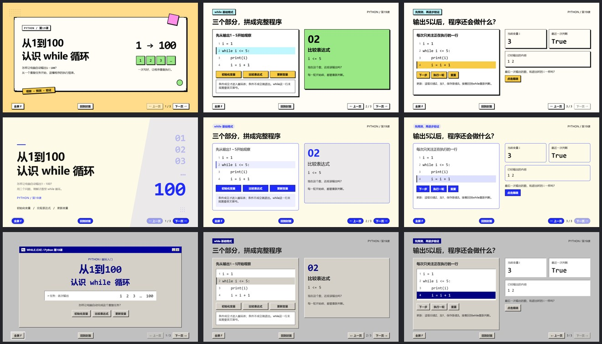

下载 HTML 后用浏览器打开。[A 彩色积木](examples/while-preview-a.html) · [B 蓝色讲义](examples/while-preview-b.html) · [C 复古窗口](examples/while-preview-c.html)

## 完整课件示例 · 5 页单文件 HTML

[下载《初识 while 循环》完整课件](examples/while-lesson.html)。用浏览器离线打开这一个 HTML 文件即可上课，按方向键翻页、按 `F` 全屏、按 `D` 开关画笔。五页依次为封面、代码结构、单步执行、两步纠错和独立编程。课堂练习的参考代码点击后显示。

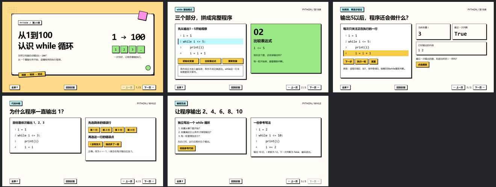

## Beautiful HTML Templates · 五种版式示例

仓库内含 34 套模板。这里选出风格不同的五套，每套展示**一页封面和一页内容**。图片来自 Zara Zhang 的模板库示例，点击模板名称可查看本仓库中的原始模板文件。

| 模板 | 封面 | 内容页 |
| --- | --- | --- |
| [BlockFrame](.agents/skills/beautiful-html-templates/templates/block-frame/template.html) 彩色积木 | 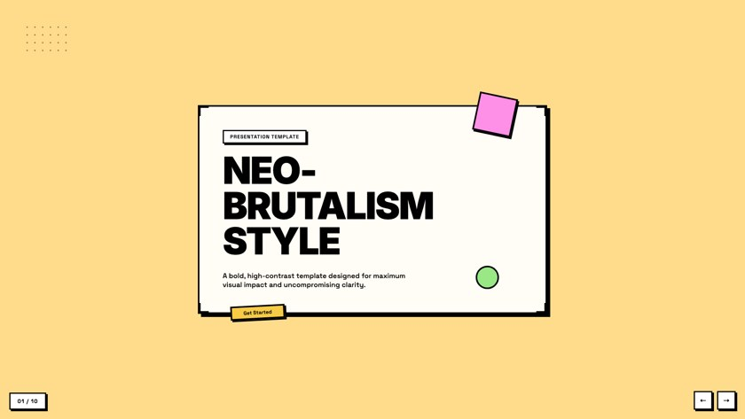 | 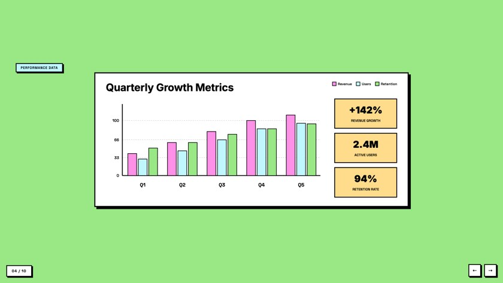 |
| [Cobalt Grid](.agents/skills/beautiful-html-templates/templates/cobalt-grid/template.html) 钴蓝网格 | 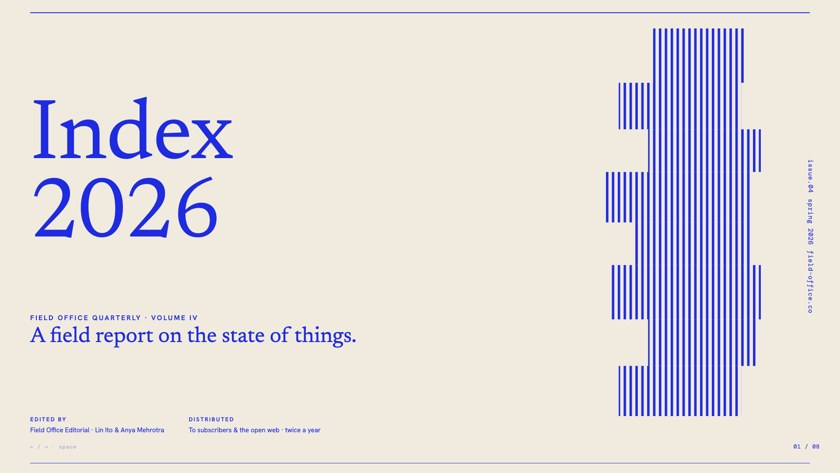 | 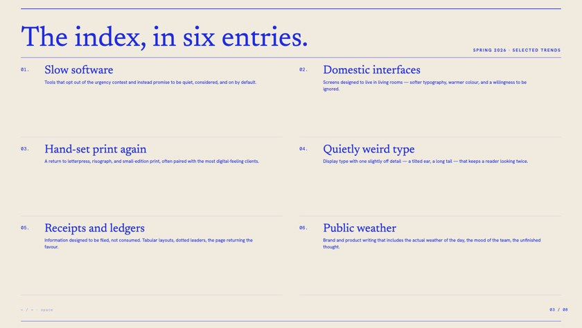 |
| [Capsule](.agents/skills/beautiful-html-templates/templates/capsule/template.html) 柔彩胶囊 | 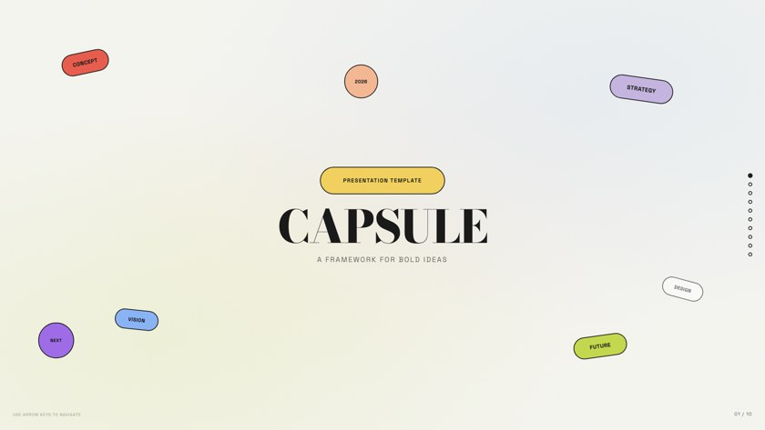 | 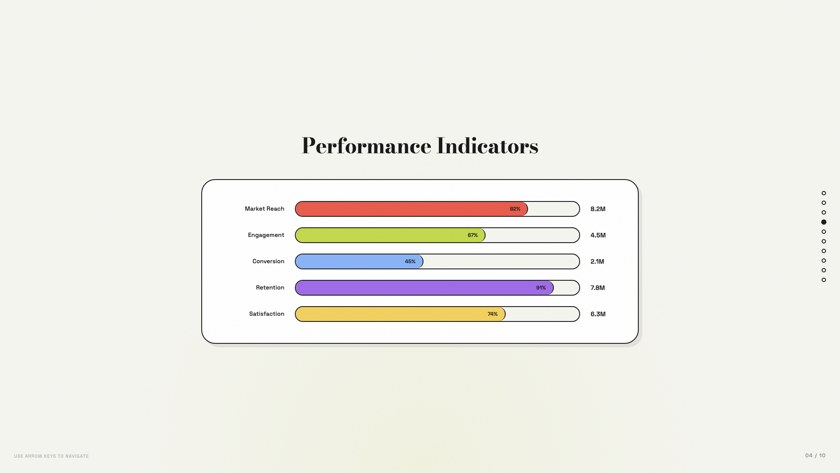 |
| [Retro Windows](.agents/skills/beautiful-html-templates/templates/retro-windows/template.html) 复古窗口 | 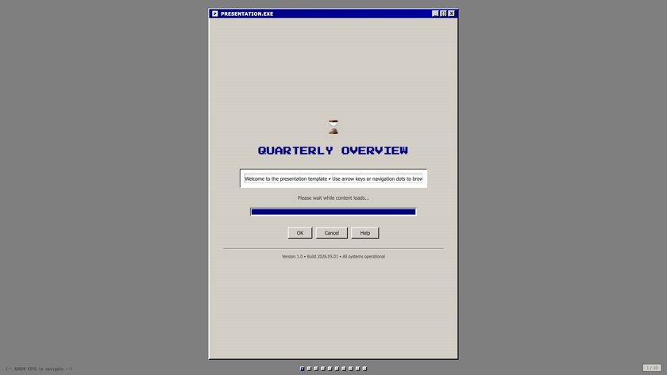 | 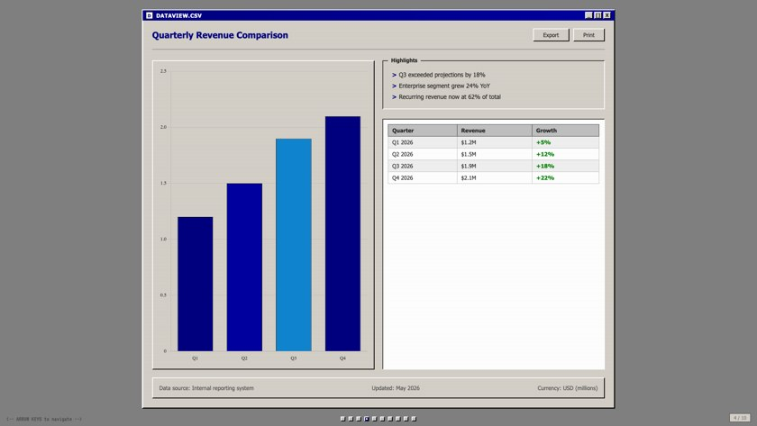 |
| [Editorial Forest](.agents/skills/beautiful-html-templates/templates/editorial-forest/template.html) 森林绿编辑风 | 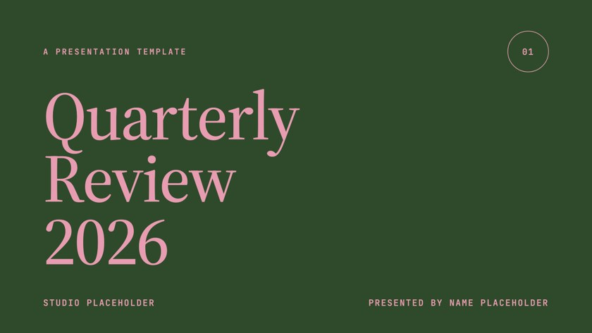 | 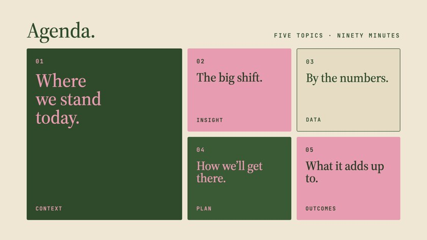 |

## 配套练习 · 两页学生版

下面两张是《函数的参数与返回值》的实际 Word 渲染。左边是知识梳理、选择和填空，右边是判断和解答。可编辑 Word 另附独立答案页。

| 第 1 页 | 第 2 页 |
| --- | --- |
| 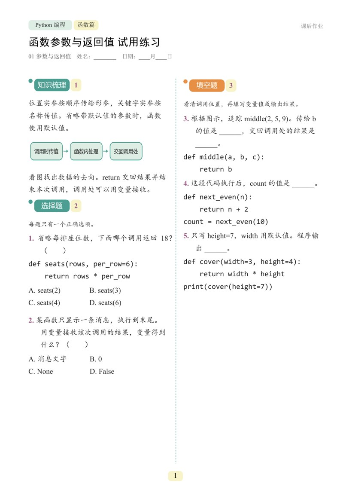 | 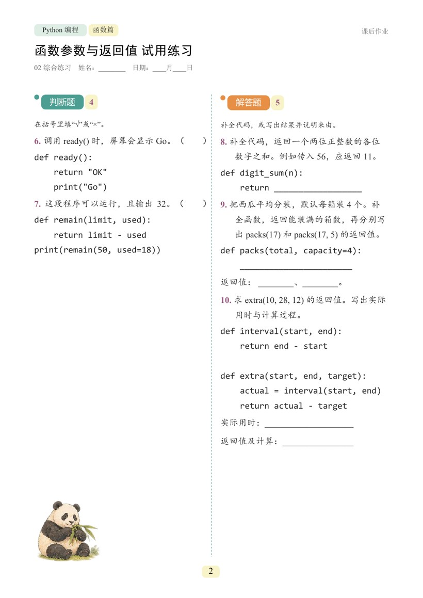 |

[下载这份 Word 练习与答案](examples/python-worksheet-sample.docx) · [查看四种题型 Word 样张](examples/worksheet-sample.docx)

### 水彩动物素材

仓库附有 [35 张水彩动物透明 PNG 原图](assets/stickers/)，下图展示其中六张。每份练习选一张，等比例放在学生页左下方。上面第 2 页是熊猫贴纸的实际效果。

## 在 Codex 中使用

下载或克隆仓库，用 Codex 打开仓库根目录，提供专题、学生程度、目标和已有教材。

| 入口 | 何时用 |
| --- | --- |
| `$frontend-slides` | 从教学结构到正式交互课件。模板库可用时调用它选版。 |
| `$beautiful-html-templates` | 单独浏览、比较或套用 HTML 模板。 |
| `$artifact-template-maths-worksheet-2` | 单独制作可编辑的 Word 练习与答案。 |

> 用 $frontend-slides 为 Python 初学者做一节「while 循环」课。让学生先预测，再单步查看变量变化。先给我教学结构，确认后给我三套风格预览。

PPTX 转换需要 Python 和 `python-pptx`。Word 版式建议用 Microsoft Word 检查。练习模板默认使用仓库自带的贴纸素材，也可以在请求中指定自己的素材目录。

## 作者与许可

教师备课工作流改编及 Word 配套练习模板由 [lianshu-codex](https://github.com/lianshu-codex) 整理。感谢 Zara Zhang 提供两项上游项目。上游文件分别保留原作者的 MIT 许可证：[Frontend Slides](.agents/skills/frontend-slides/LICENSE) · [Beautiful HTML Templates](.agents/skills/beautiful-html-templates/LICENSE)。本仓库新增内容采用 [MIT 许可证](LICENSE)。
